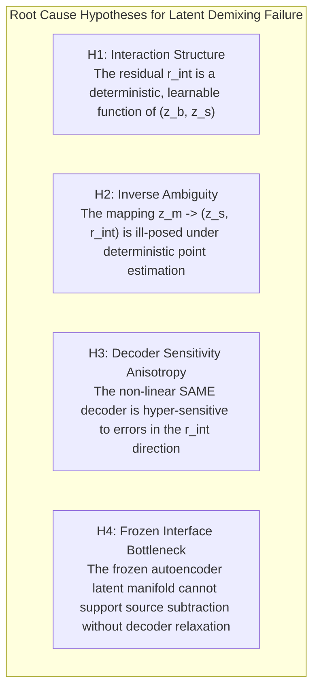
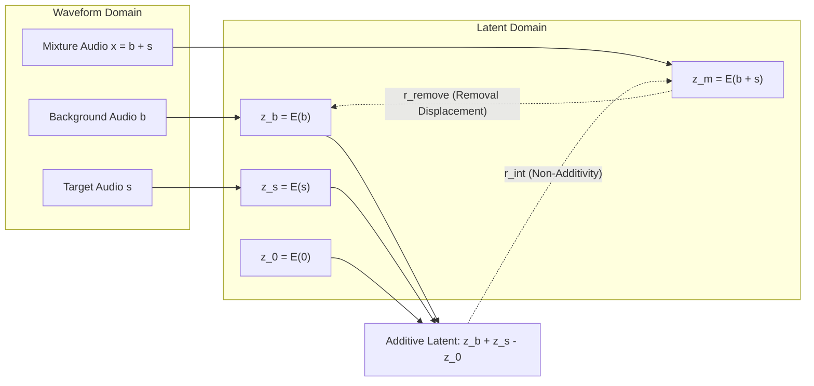
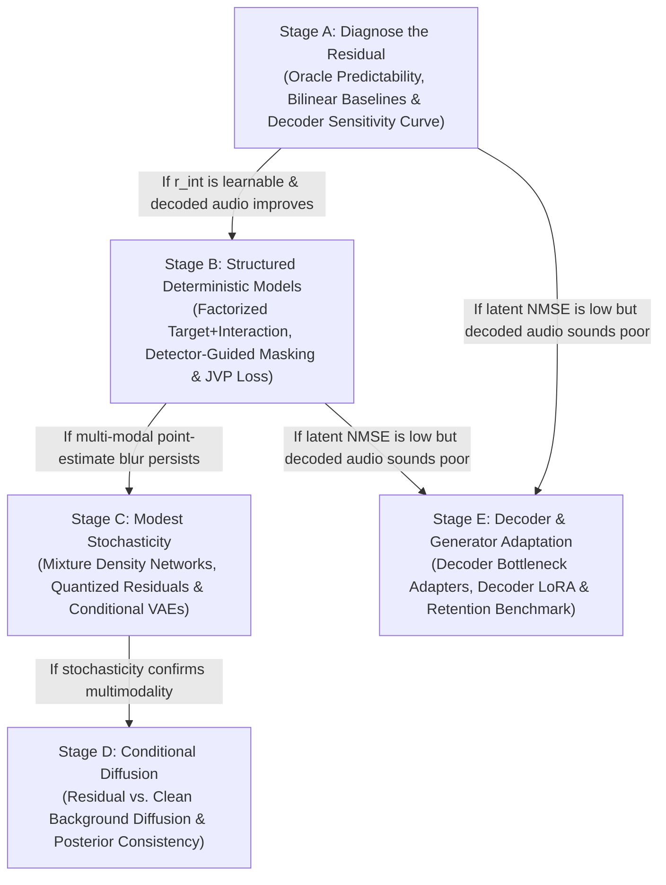

# Phase 9 Master Plan: Non-Linear Residual Interaction, Decoder Sensitivity, and Generator Adaptation in SAME Latent Space

**Programme:** SAME Latent Research — Phase 9 & Beyond  
**Branch:** `research/phase9-residual-and-decoder-adaptation`  
**Date:** November 7, 2026  
**Authors:** Research & Engineering (Antigravity / DeepMind Pair Programming with Kim Åke)  
**Status:** Approved Master Roadmap & Active Execution Plan

---

## 1. Executive Charter & The Core Scientific Challenge

Over nine audited phases (Phases 0 through 8), we established the foundational properties of Stable Audio 3's frozen autoencoder latent space (**SAME**):
- **Frozen SAME latents are effective musical analyzers and context locators:** They support 83.0% macro F1 sound recognition on unseen patches, 83.3% exemplar-conditioned retrieval, and sub-2 ms onset timing under learned fine-rate upsampling (84.4% 10ms F1, 1.71 ms onset MAE in the decisive capacity-matched control).
- **Lightweight deterministic latent subtraction and residual regression fail to demix audio:** Every tested deterministic feedforward separator underperformed the untouched mixture, scoring **-3.8 dB to -11.5 dB worse than doing nothing at all**.
- **This failure coincides with a 51.7% non-linear interaction residual:** Waveform superposition $x = b + s$ does not map to linear addition in latent space.

The objective of Phase 9 is **not** to rush prematurely into training a massive multi-hundred-million-parameter conditional diffusion separator. Rather, Phase 9 targets the residual directly to isolate the root cause of demixing failure across four distinct hypotheses:

Phase 9 organizes this investigation into three progressively more ambitious tracks:
1. **Track 1:** Model the non-linear interaction residual explicitly (Stages A & B).
2. **Track 2:** Replace point estimation with conditional generative and uncertainty modeling (Stages C & D).
3. **Track 3:** Adapt the decoder or autoencoder interface if the frozen latent space is an architectural bottleneck (Stage E).

---

## 2. Mathematical Taxonomy: Disentangling the Two Residuals

A primary methodological flaw in earlier literature and ad-hoc experiments is conflating two completely different latent residual vectors:

### 2.1 The Non-Additivity Interaction Residual ($r_{\text{int}}$)
For background $b$, target $s$, and silence reference $z_0 = E(0)$:
$$r_{\text{int}} = E(b + s) - E(b) - E(s) + E(0)$$

Equivalently:
$$z_m = z_b + z_s - z_0 + r_{\text{int}}$$

$r_{\text{int}}$ characterizes the **encoder's non-linearity under acoustic superposition**. It captures acoustic masking, spectral collisions, dynamic range compression, and convolutional boundary effects inside the encoder.

### 2.2 The Removal Displacement ($r_{\text{remove}}$)
The latent change required to recover the encoded background from the mixture latent is:
$$r_{\text{remove}} = z_m - z_b$$

Substituting the definition of $z_m$:
$$r_{\text{remove}} = z_s - z_0 + r_{\text{int}}$$

> [!IMPORTANT]
> **The Core Inequality:**
> $$r_{\text{remove}} \neq r_{\text{int}}$$
> A deployable background-recovery system cannot simply estimate $r_{\text{int}}$. It must estimate **both** the isolated target contribution $(z_s - z_0)$ **and** its context-dependent interaction with the background ($r_{\text{int}}$).

---

## 3. The 5-Stage Concrete Experiment Ladder

---

### Stage A: Diagnose the Residual (Immediate Foundation)

#### Experiment A.1: Oracle Interaction Prediction
- **Scientific Question:** Given the two isolated encoded components $(z_b, z_s)$, is their interaction approximately deterministic?
- **Target:** $r_{\text{int}} = z_m - z_b - z_s + z_0$.
- **Model:** $\hat{r}_{\text{int}} = f_\theta(z_b, z_s)$.
- **Architectures & Baselines:**
  1. $\hat{r}_{\text{int}} = 0$ (Additive null hypothesis).
  2. Global mean: $\hat{r}_{\text{int}} = \bar{r}_{\text{train}}$.
  3. Class-conditional mean by target family.
  4. Local Bilinear interaction model:
     $$\hat{r}_{\text{int}, t} = W_o \left[ (W_b z_{b, t}) \odot (W_s z_{s, t}) \right]$$
  5. Local 1D Temporal Convolution (3-layer CNN, receptive field $w \in \{1, 3\}$).
  6. Contextual Sequence Model (1D Conv + Self-Attention / BiLSTM).
- **Loss Functions:**
  - Standardized MSE:
    $$L_{\text{int}} = \frac{1}{CT} \left\| \Sigma^{-1/2} (\hat{r}_{\text{int}} - r_{\text{int}}) \right\|_2^2$$
    where $\Sigma$ is the training-set diagonal covariance / per-channel standard deviation.
  - Unstandardized NMSE:
    $$\text{NMSE}_r = \frac{\|\hat{r}_{\text{int}} - r_{\text{int}}\|_2^2}{\|r_{\text{int}}\|_2^2 + \epsilon}$$
- **Acoustic Decoded Validation:**
  $$\hat{z}_b = z_m - z_s + z_0 - \hat{r}_{\text{int}}$$
  $$\hat{b} = \mathcal{D}(\hat{z}_b)$$
  Measure waveform $\text{SDR}(b, \hat{b})$ against:
  - Naive subtraction ($\hat{r}_{\text{int}} = 0$)
  - Untouched mixture ($b + s$)
  - Autoencoder ceiling $\mathcal{D}(\mathcal{E}(b))$

#### Experiment A.2: Local vs. Contextual Decomposition
Decompose the residual:
$$r_{\text{int}} = r_{\text{local}} + r_{\text{context}}$$
- **Local branch:** $f_{\text{local}}(z_{b, t-w:t+w}, z_{s, t-w:t+w})$ (transients, phase-sensitive overlap, spectral masking).
- **Context branch:** $f_{\text{context}}(z_b, z_s)$ (sustained pads, repeated rhythmic structure, compression envelope).
- Combined: $\hat{r}_{\text{int}} = \hat{r}_{\text{local}} + \hat{r}_{\text{context}}$ with near-zero initialization.

#### Experiment A.3: Decoder Sensitivity Mapping $Q(\epsilon, u)$
- **Scientific Question:** Does the SAME decoder exhibit directional anisotropy? Are errors in the direction of $r_{\text{int}}$ more acoustically damaging than random isotropic errors?
- **Protocol:** For clean background $z_b = \mathcal{E}(b)$, add controlled perturbations:
  $$\tilde{z}_b = z_b + \epsilon u, \quad \|u\|_2 = 1$$
  across $\epsilon \in [0.005, 0.01, 0.02, 0.05, 0.1, 0.2, 0.5, 1.0, 2.0]$.
- **Directions ($u$):**
  1. `isotropic_random`: $u \sim \mathcal{N}(0, I)$
  2. `pca_top_1`: Dominant eigenvector of latent space
  3. `pca_bottom_1`: Minor eigenvector of latent space
  4. `sae_atom`: Top active SAE feature atom
  5. `interaction_residual`: $u = r_{\text{int}} / \|r_{\text{int}}\|_2$
  6. `separator_error`: $u = (z_{\text{sep}} - z_b) / \|z_{\text{sep}} - z_b\|_2$ (from Phase 5 separator)
- **Output:** The sensitivity curve $Q(\epsilon, u) = \operatorname{SDR}(b, \mathcal{D}(z_b + \epsilon u))$.

---

### Stage B: Structured Deterministic Models (Inference-Deployable)

#### Experiment B.1: Factorized Target-Plus-Interaction Prediction
- **Inputs:** Mixture latent $z_m = \mathcal{E}(b+s)$ and query exemplar $q$.
- **Model:** $(\hat{z}_s, \hat{r}_{\text{int}}) = f_\theta(z_m, q)$.
- **Reconstruction:** $\hat{z}_b = z_m - \hat{z}_s + z_0 - \hat{r}_{\text{int}}$.
- **Loss:**
  $$L = \lambda_s \|\hat{z}_s - z_s\|_1 + \lambda_{\text{int}} \|\hat{r}_{\text{int}} - r_{\text{int}}\|_1 + \lambda_b \|\hat{z}_b - z_b\|_1$$
- **Ablation Baseline:** Capacity-matched direct predictor $\hat{z}_b = f_{\text{direct}}(z_m, q)$.

#### Experiment B.2: Detector-Guided Residual Masking
- Front-end: Use Phase 4 Exemplar-Conditioned Detector activation $a(t) = P(\text{target active at } t \mid z_m, q)$.
- Dilated soft mask: $\tilde{a} = \operatorname{DilateSmooth}(a)$ to preserve reverb tails and open hi-hat decays.
- Gated removal: $\hat{r}_{\text{remove}} = \tilde{a} \odot f_\theta(z_m, q)$.
- Comparison: No prior vs. Oracle GT activity prior vs. Predicted activity prior vs. Hard mask vs. Dilated soft prior.

#### Experiment B.3: Decoder Jacobian-Vector Product (JVP) Loss
Weight latent errors by their linearized waveform impact:
$$L_{\text{JVP}} = \left\| J_{\mathcal{D}}(z_b) (\hat{z}_b - z_b) \right\|_2^2$$
computed efficiently via reverse-mode autodiff forward vector products without forming the full $4096 \times 256$ Jacobian matrix.

#### Experiment B.4: Perceptually Weighted Decoded Losses
- **Multi-resolution complex STFT loss:** $L_{\text{complex}} = \frac{1}{R} \sum_r \|S_r(\hat{b}) - S_r(b)\|_1$
- **Spectral convergence:** $L_{\text{SC}} = \frac{\||S(\hat{b})| - |S(b)|\|_F}{\||S(b)|\|_F + \epsilon}$
- **Log-magnitude loss:** $L_{\log} = \|\log(|S(\hat{b})| + \epsilon) - \log(|S(b)| + \epsilon)\|_1$
- **Transient-weighted loss:** $L_{\text{transient}} = \frac{\sum_n w[n] |\hat{b}[n] - b[n]|}{\sum_n w[n] + \epsilon}$ derived from target onset envelopes.

---

### Stage C: Modest Stochasticity (Pre-Diffusion)

Before committing to heavy diffusion backbones, test whether low-order multimodality resolves the conditional blur:

1. **Mixture Density Network (MDN):**
   Predict $K \in \{4, 8\}$ candidate latent backgrounds:
   $$p(z_b \mid z_m, q) = \sum_{k=1}^K \pi_k \mathcal{N}\left(z_b; \mu_k, \operatorname{diag}(\sigma_k^2)\right)$$
   Train with Negative Log-Likelihood: $L_{\text{NLL}} = -\log \sum_k \pi_k \mathcal{N}(z_b; \mu_k, \sigma_k^2 I)$.
2. **Quantized Residual Codebook (VQ):**
   Train a VQ-VAE on $r_{\text{remove}} = z_m - z_b$. Predict discrete residual codes with cross-entropy conditioned on $(z_m, q)$, avoiding continuous regression-to-the-mean averaging.
3. **Conditional VAE (CVAE):**
   Encode background into stochastic variable $u \sim \mathcal{N}(0, I)$ conditioned on $(z_m, q)$.
4. **Evaluation:** Report Mean, Median, and Best-of-$K$ quality.

---

### Stage D: Conditional Latent Diffusion

If Stage C confirms that multimodality is essential:

1. **Target Comparison:**
   - **Branch 1 (Clean Background Diffusion):** $z_t = \alpha_t z_b + \sigma_t \epsilon$.
   - **Branch 2 (Residual Diffusion):** $r_t = \alpha_t r_{\text{remove}} + \sigma_t \epsilon$.
2. **Conditioning Scheme:** $c = (z_m, e_q, \tilde{a}(t))$.
3. **$v$-Parameterization Objective:** $L_v = \mathbb{E}[\|v_\theta(z_t, t, c) - v\|_2^2]$ where $v = \alpha_t \epsilon - \sigma_t z_b$.
4. **Classifier-Free Guidance (CFG):** Drop conditioning $c = \varnothing$ with $p_{\text{drop}} = 0.15$; sample with $w \in [1.0, 3.0]$.
5. **Mixture-Consistency Posterior Refinement:**
   $$(\hat{z}_b^*, \hat{z}_s^*) = \arg\min_{z_b, z_s} \left[ \|\mathcal{D}(z_b) + \mathcal{D}(z_s) - x\|_2^2 + \lambda_b \|z_b - \hat{z}_b\|_2^2 + \lambda_s \|z_s - \hat{z}_s\|_2^2 \right]$$
6. **Strict Multi-Sample Evaluation:**
   Draw $M = 8$ samples per mixture. Report Mean sample SDR, Median sample SDR, Best-of-$M$ (explicitly labeled oracle ceiling), sample diversity, and hallucinated-event rate.

---

### Stage E: Generator & Decoder Adaptation

If the frozen SAME latent manifold remains uncooperative:

1. **Decoder Bottleneck Adapters:**
   Insert trainable adapters $h_l' = h_l + W_{\text{up}} \phi(W_{\text{down}} h_l + P_l c)$ into frozen decoder residual blocks.
2. **Decoder LoRA:**
   Low-rank adaptation $\Delta W = \frac{\alpha}{r} B A$ ($r \in \{4, 8, 16, 32\}$) on attention and 1D conv projections.
3. **Reconstruction-Retention Benchmark:**
   $$L_{\text{retain}} = \|\mathcal{D}_\psi(\mathcal{E}(x), c_{\text{identity}}) - x\|_1$$
   guaranteeing that adapted decoders do not corrupt general audio synthesis fidelity.
4. **Separation Bottleneck / Flow Interface:**
   Learn a separation-friendly interface $u = T_\phi(z)$ penalizing non-additivity $L_{\text{add}} = \|u_m - u_b - u_s + u_0\|_1$ regularized by reconstruction and contrastive objectives.
5. **Waveform Teacher Distillation:**
   Distill high-capacity waveform separation models (e.g. BS-Roformer) into the latent separator:
   $$L = \lambda_{\text{true}} \|\hat{z}_b - \mathcal{E}(b)\|_1 + \lambda_{\text{teacher}} \|\hat{z}_b - \mathcal{E}(\tilde{b}_{\text{teacher}})\|_1$$

---

## 4. Rich Multitrack, MIDI & MIR Assets Available for Phase 9

We have an extensive, uncompromised collection of ground-truth assets:
1. **Dataset A (Isolated Clean Samples):** 281 dry, isolated acoustic and electronic drum hits, percussion, and synth notes categorized into 6 sound families.
2. **Dataset C (Real Multitrack Stems):** Complete multitrack session stems from Kim Åke's Aavepyörä album projects (dry basslines, separated drum machine tracks, synth leads, pads, FX stems).
3. **Dataset B (Controlled Synthetic Mixtures):** 1,000 synthetic mixtures with exact ground-truth components, gain levels, and sub-frame offset annotations.
4. **Muscriptor Ground-Truth MIDIs:** Multi-track MIDI transcriptions with velocity, onset, and duration maps.
5. **Frame-Level MIR Data:** Beat positions, transient onset envelopes, and spectral centroid/flux maps for temporal alignment and loss weighting.

---

## 5. Unified Execution Protocol & Git Workflow

- **Branch Name:** `research/phase9-residual-and-decoder-adaptation` in `stable-audio-tools`.
- **Scripts Location:** `research/phase9_residual/` and `batch9_phase9_residual_diagnostics/`.
- **Central Execution Log:** All results, metrics, anomalies, and diagnostic figures will be appended chronologically to:
  `research/phase9_residual/PHASE9_EXECUTION_LOG.md`.
- **Git Commit Discipline:** Every completed test stage will be committed and pushed to `origin/research/phase9-residual-and-decoder-adaptation` with clean commit messages.
- **Integrity Rule:** Zero oracle data at inference, zero fabrication, and mandatory baseline comparisons against the untouched mixture and clean autoencoder ceiling.
