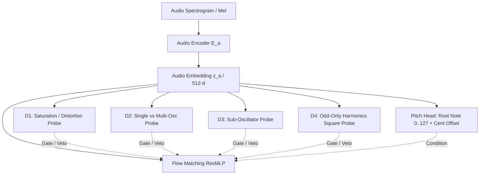

# V6 Architectural Proposal: Internal Discriminators, Pitch Prediction, and Acoustic Disentanglement

**Owner:** KIM & KUANG  
**Date:** 2026-10-19  
**Status:** Approved Blueprint for V6 & Flow-DPO Integration  
**Preceding Models:** V5 Stage 4 (126-d Categorical Octaves), V5 Stage 5 (16.5h Differentiable Acoustic Flow)

---

## 1. Executive Summary

While Stage 5 solved the muffled filter cutoff problem on held-out presets and real stems via differentiable Synth-JEPA acoustic consistency loss ($\mathcal{L}_{\text{acoustic}}$), listening audits reveal several persistent failure modes when inverting arbitrary synth audio:
1. **Waveform Ambiguity:** Inverting pure Square/Pulse sounds with bright Sawtooth waves (or vice-versa).
2. **Spurious Dual-Filter / Dual-Oscillator Diffusion:** Adding complex multi-oscillator detuning, feedback, or secondary filter routings to fundamentally single-oscillator sounds.
3. **Octave Transposition Drift:** Transposing the master oscillator (OSC1) by $-3$ or $+2$ octaves, producing sub-audible rumbles or shrieking leads.
4. **Distortion / Preamp Guessing:** Inadvertently enabling waveshapers or preamp drive on clean analog plucks.
5. **Lack of Autonomous Pitch Estimation:** Requiring external MIDI files or external pitch followers rather than predicting pitch end-to-end within the network.

To resolve these fundamentally, V6 introduces:
- **Internal Auxiliary Attribute Discriminators** on the audio encoder $E_a$ acting both as representation shaping losses and inference rejection gates.
- **Strict Master Pitch Anchoring:** Locking OSC1 to $\pm 1$ octave (or Unison $0$).
- **Realistic Oscillator Detuning ($\pm 0.2$ semitones):** Activating micro-detuning in 20% of prior draws.
- **Internal Pitch Prediction Head:** 128-class discrete semitone classification + continuous cent offset regression.

---

## 2. Acoustic Attribute Discriminators ("Internal Probes")

Instead of forcing a single monolithic flow vector to simultaneously guess high-level topology and continuous parameter micro-tunings, the audio encoder $E_a$ is equipped with lightweight auxiliary binary probes:
$$\hat{y}_j = \sigma(W_j \cdot \text{GELU}(V_j z_a + b_j)) \in [0, 1]$$



### 2.1 Discriminator 1: Saturation & Distortion Active
- **Why Crest Factor Fails on Solo Sounds:**  
  Crest factor ($C = x_{\text{peak}} / x_{\text{rms}}$) is heavily confounded by the Amplitude Envelope (AEG attack/decay shapes), low-pass filter phase rotation, and basic oscillator geometry (e.g. pure sine $C \approx 1.41$, saw $C \approx 1.73$, pulse waves varying widely with duty cycle). A soft-attack distorted lead can have a lower crest factor than a sharp clean pluck.
- **The Correct Acoustic Formulation:**  
  Non-linear saturation is characterized by **waveform geometry compression** (symmetrical/asymmetrical flattening of waveform peaks in the normalized time domain) and **harmonic proliferation over frequency bins** ($k \cdot f_0$ partials extending above the linear filter slope).
- **Immunity to Ring Modulation (RM) Sidebands:**  
  Ring modulation generates sum and difference sidebands ($f_c \pm f_m$). These sidebands are distinct from non-linear harmonic distortion because they do not necessarily fall on integer multiples of the carrier. The discriminator learns spectral distribution patterns that distinguish true harmonic overtones (integer multiples) from RM sidebands.
- **Ground Truth Definition in Surge XT:**
  $$y_{\text{dist}} = \mathbb{I}\left( \text{ws\_idx} > 0 \lor \text{drive} > 0.15 \right)$$

### 2.2 Discriminator 2: Single vs. Multi-Oscillator & Phase Interference
- **Acoustic Signature:**  
  Single-oscillator patches exhibit stable, coherent harmonic phase trajectories. When multiple oscillators or unison voices are active, phase interference creates:
  - Amplitude beating / envelope ripple at rate $\Delta f = |f_1 - f_2|$.
  - Phase cancellation nulls across the frequency spectrum.
  - Multi-harmonic combs when oscillators are tuned to intervals (octaves, 4ths, 5ths).
- **Ground Truth Definition in Surge XT:**
  $$y_{\text{multi}} = \mathbb{I}\left( \text{osc\_2\_vol} > 0.10 \lor \text{osc\_3\_vol} > 0.10 \lor \text{unison\_voices} > 1 \right)$$
- **Inference Gate:** If $P(\text{multi}) < 0.15$, clamp `osc_2_volume = 0.0`, `osc_3_volume = 0.0`, and `unison = 1 voice`.

### 2.3 Discriminator 3: Sub-Oscillator Active
- **Acoustic Signature:**  
  A main note at $f_0 = 220\text{ Hz}$ produces harmonics at $220, 440, 660, 880\text{ Hz}$.  
  When an explicit sub-oscillator is added at $f_{\text{sub}} = 110\text{ Hz}$ ($f_0 / 2$), it interleaves partials at $110, 330, 550, 770\text{ Hz}$.
  The resulting spectrum displays **alternating bin volumes** and a doubling of spectral peak density below 1 kHz. If the sub is an analog-style detuned oscillator, it introduces low-frequency phase beating against the fundamental.
- **Ground Truth Definition in Surge XT:**
  $$y_{\text{sub}} = \mathbb{I}\left( \text{sub\_mix} > 0.10 \lor (\text{osc\_2\_vol} > 0.10 \land \text{osc\_2\_octave} < 0) \lor (\text{osc\_3\_vol} > 0.10 \land \text{osc\_3\_octave} < 0) \right)$$

### 2.4 Discriminator 4: Odd-Only Harmonics (Square / Pulse vs. Sawtooth)
- **Acoustic Signature:**  
  - **Sawtooth:** Full harmonic comb containing both even and odd partials ($1f_0, 2f_0, 3f_0, 4f_0, \dots$).
  - **Square / Symmetrical Pulse:** Energy concentrated strictly at odd partials ($1f_0, 3f_0, 5f_0, \dots$); even partials ($2f_0, 4f_0, 6f_0$) are nominally zero.
  - **Even/Odd Harmonic Ratio (EOHR):**
    $$\text{EOHR} = \frac{\sum_{k=1}^K |X(2k f_0)|}{\sum_{k=1}^{2K} |X(k f_0)| + \epsilon}$$
    $\text{EOHR} \approx 0 \implies$ Pure Square. $\text{EOHR} \ge 0.25 \implies$ Sawtooth / Complex.
- **Ground Truth Definition in Surge XT:**
  $$y_{\text{odd\_only}} = \mathbb{I}\left( \text{shape} > 0.65 \land \text{sub\_mix} < 0.05 \land \text{osc\_2\_vol} < 0.10 \right)$$
- **Inference Gate:** If $P(\text{odd\_only}) > 0.80$, reject any candidate where $\text{shape} < 0.40$.

---

## 3. Structural Constraints on the Parameter Space

### 3.1 Locking OSC1 to $\pm 1$ Octave (or Unison 0)
- In `surge_spec_v5.py`, OSC1 was permitted 7 discrete octaves: $\{-3, -2, -1, 0, +1, +2, +3\}$.
- **The Problem:** The inverter frequently transposes OSC1 by $-3$ or $+2$ octaves, guessing extreme octave offsets to compensate for filter cutoff errors, which destroys melodic coherence.
- **V6 Upgrade:**
  - `osc_1_octave` is locked strictly to **$\{-1, 0, +1\}$** (3 classes) or strictly fixed to **Unison $0$**.
  - OSC 2 and OSC 3 retain full interval range ($-2, -1, 0, +1, +2$) to support sub-oscillators, 5ths, and octaves.
  - This ensures OSC1 acts as the invariant master pitch reference.

### 3.2 Activating Oscillator Detuning ($\pm 0.2$ Semitones) in 20% of Prior Draws
- In analog and midrange synth sounds, multi-oscillator patches rely on slight oscillator detuning ($\pm 5$ to $\pm 20$ cents) for warmth, chorus-like phase animation, and stereo width.
- **Surge Specification:**
  - Parameters: `osc_2_pitch` and `osc_3_pitch`.
  - Continuous mapping: raw value $p \in [0, 1] \implies \Delta f = \pm 0.20$ semitones.
- **Prior Sampling:**
  - For 80% of multi-oscillator draws: detuning is $0$ (phase-locked or integer intervals).
  - For 20% of multi-oscillator draws: `osc_2_pitch` and `osc_3_pitch` are uniformly sampled across $[-0.2, +0.2]$ semitones.

---

## 4. Internal Pitch Prediction Head

### 4.1 Architecture
On top of $z_a = E_a(\text{mel}) \in \mathbb{R}^{512}$:
```python
class DualPitchHead(nn.Module):
    def __init__(self, embed_dim=512):
        super().__init__()
        self.coarse_mlp = nn.Sequential(
            nn.Linear(embed_dim, 256),
            nn.GELU(),
            nn.Linear(256, 128)  # 128 MIDI semitones (0..127)
        )
        self.fine_mlp = nn.Sequential(
            nn.Linear(embed_dim, 128),
            nn.GELU(),
            nn.Linear(128, 1),   # Cent offset in [-50, +50] cents
            nn.Tanh()
        )

    def forward(self, z_a):
        logits = self.coarse_mlp(z_a)
        cent_offset = self.fine_mlp(z_a) * 50.0  # [-50, +50] cents
        return logits, cent_offset
```

### 4.2 Multi-Task Loss Formulation
During training on Surge audio where root note $M \in [28, 55]$ is known exactly:
$$\mathcal{L}_{\text{pitch}} = \text{CrossEntropy}(\hat{M}_{\text{logits}}, M^*) + \lambda_{\text{cents}} |\hat{\Delta}_{\text{cents}} - \Delta^*|$$

### 4.3 Benefit to Timbre Disentanglement
Supervising $E_a$ with $\mathcal{L}_{\text{pitch}}$ forces early convolutional and attention layers to isolate the fundamental frequency $f_0$. This prevents filter cutoff sweeps or high-resonance peaks from being mistakenly interpreted as pitch changes, leaving the rest of $z_a$ clean to encode pure timbre.

---

## 5. Execution Roadmap

1. **Step 1: Preference Fine-Tuning (Flow-DPO on Stage 5 Checkpoint)**
   - Train Flow-DPO on the 16.5h Stage 5 model using winner/loser pairs scored by Kim's composite acoustic metric:
     $$\mathcal{M} = \text{MSS} + 0.5 \cdot \mathcal{D}_{\text{contour}} + 1.0 \cdot \mathcal{D}_{\text{harmonic}}$$
   - Attach the prototype auxiliary probes during DPO pair generation.

2. **Step 2: V6 Multi-Task Base Training**
   - Incorporate `surge_spec_v6.py`:
     - Lock OSC1 to $\pm 1$ octave (3 classes).
     - Enable $\pm 0.2$ semitone detuning in 20% of prior draws.
   - Attach all 4 discriminator heads + dual pitch head to $E_a$.
   - Train end-to-end with joint loss:
     $$\mathcal{L}_{\text{total}} = \mathcal{L}_{\text{flow}} + \lambda_{\text{ac}} \mathcal{L}_{\text{acoustic}} + \lambda_{\text{disc}} \sum_{j=1}^4 \mathcal{L}_{\text{BCE}, j} + \lambda_{\text{pitch}} \mathcal{L}_{\text{pitch}}$$
