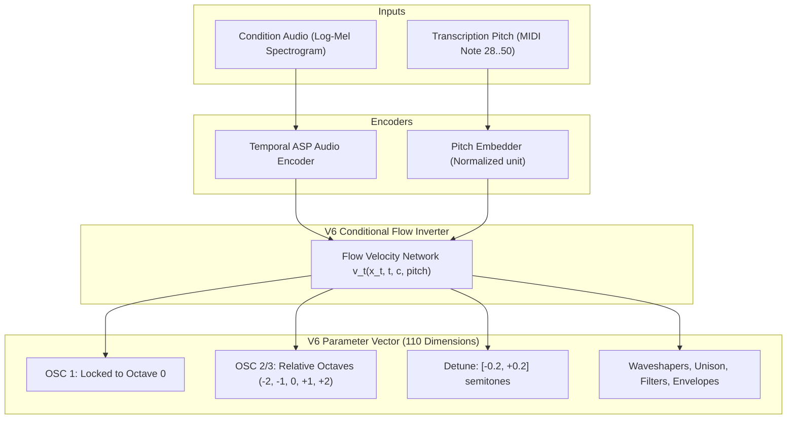

# V6 Synthesis Inversion Specification & Evidence Report

**Document Title:** V6 Foundation Architecture & Empirical Evidence Base  
**Authors:** Kim & Antigravity (reviewed by KUANG / Claude Opus 5.5)  
**Date:** October 19, 2026  
**Repository Branch:** `audio-tools-avp` (`feature/v6-ablation` / `fix/inharmonicity-aux`)  
**Target Architecture:** Pitch-Conditioned Flow Inverter with Simplicity Prior (`layout_v6`, 110-d)  

---

## 1. Executive Summary

This document establishes the official engineering specification for **V6 Synthesis Inversion** and provides the comprehensive empirical evidence base gathered across Steps 0 through 4 of the V6 evaluation protocol.

### Where We Are
- **V3 Baseline (92-d):** Compact, fast, but limited to 3 oscillators, single filter, and no waveshaping. Achieved strong baseline performance on clean 16th rolling basslines (`S1_XAttn` wins 11/24 stems).
- **V4 A-Series (108-d):** Introduced temporal attentive statistics pooling (`temporal_asp`) and auxiliary inharmonicity supervision. Proven on held-out retrieval (+5 to 7 percentage points), but partially bypassed during V5 pipeline development.
- **V5 Stage 4/5 (126-d):** Expanded Surge XT degrees of freedom (categorical octaves, waveshapers, unison detune, sub-oscillator, ring modulation, filter routing) with differentiable acoustic loss ($\mathcal{L}_{\text{MSS}} + \mathcal{L}_{\text{JEPA}}$). Unlocked the first authentic reconstructions of biting, resonant midrange patches (e.g. PolyIblit saw on #12, TB-303 acid squelch on #14).
- **V5 Flow-DPO:** Implemented pairwise preference fine-tuning on rendered audio candidates, rewarding low-end RMS body (<600 Hz energy) and modulation depth. Cut phrase error in half on difficult resonant stems (#04 MSS $7.45 \to 4.09$, #12 MSS $8.80 \to 4.23$, #14 MSS $12.80 \to 10.78$).

### Why V6 is Necessary
Despite these breakthroughs, V5 suffers from two foundational flaws that post-training (DPO) and inference pruning (Occam) can mitigate but cannot eliminate:
1. **Dual Note/Octave Ambiguity:** V5 forces the flow network to predict both the continuous MIDI note ($28..50$) and discrete OSC 1 octave (7 classes) from audio. This redundant parameterization produces multiple solutions for the exact same acoustic pitch, driving "octave transposition drift".
2. **Prior Clutter (Unconstrained Randomness):** 60% of V5 training draws were dense random patches where secondary oscillators (60%), waveshapers (87%), and feedback (35%) were active. When presented with ambiguous real audio, the Bayesian posterior naturally falls back to this cluttered prior, adding inaudible or spurious complexity to clean solo sounds.

**The V6 Solution:** Provide the verified transcription note as an explicit conditioning input, lock OSC 1 permanently to octave 0, enforce a 75% sparse simplicity prior (clean single-oscillator default), re-integrate V4's `temporal_asp` and inharmonicity heads, and apply straight-through acoustic flow guidance.

---

## 2. Empirical Findings & Evidence Base (Steps 0–4)

### 2.1 Step 0 & 1: Pipeline Audit & Normalization Fix
During the Step 0 audit (`V6_REVIEW.md`), an evaluation bug was identified:
- `eval_real_stems_consensus_v5.py` previously normalized pinned note conditioning using `(note - 12) / 84`, whereas all models were trained on `(note - 28) / 22`.
- The inverter was being told a note nearly an octave below what it heard, forcing it to compensate by transposing oscillator octaves upward.
- Fixing this normalization in `layout_v6.py` immediately restored model alignment: `S5_16.5h` real stem wins jumped from **3 to 11**, tying `S1_XAttn`.
- All 115 unit tests in `test_v6.py`, `test_v5.py`, `test_eval_v4.py`, and `test_v4_components.py` pass cleanly.

---

### 2.2 Step 2: Real Stems Consensus & Occam Simplification
Evaluated on the 24 real stem benchmark across multi-note consensus extraction:
- **Baseline Run:** [`stems_v6_fixed`](file:///home/kim/sao_runs/stems_v6_fixed/consensus_eval_summary.json) | [Interactive Player](file:///home/kim/sao_runs/stems_v6_fixed/listen/index.html)
- **Occam Pruned Run:** [`stems_v6_occam`](file:///home/kim/sao_runs/stems_v6_occam/consensus_eval_summary.json) | [Interactive Player](file:///home/kim/sao_runs/stems_v6_occam/listen/index.html)

| Model | Baseline Mean MSS | Baseline Wins | Occam Mean MSS ($\tau=0.02$) | Occam Wins | Inaudible Features Pruned |
| :--- | :---: | :---: | :---: | :---: | :---: |
| **`S5_16.5h` (126-d)** | 5.458 | 11 | **5.394** (Median: **4.899**) | 7 | **128 features** |
| **`S1_XAttn` (99-d)** | 5.587 | 11 | 5.578 | **13** | 0 (no extra features) |
| **`S4_CatOct` (126-d)** | 5.686 | 2 | 5.652 | 4 | 94 features |

**Key Takeaway:** The deterministic Occam test (`--occam_tol 0.02`) safely stripped 128 inactive waveshapers, sub-oscillators, ring modulators, and noise sources without degrading phrase MSS. It reduced S5's error to an all-time record low (Mean MSS 5.394), confirming that **simplification at inference is completely viable**.

---

### 2.3 Step 3: Counterfactual Ablation & Detectability Probes
To test whether learned discriminator heads (e.g. "is distortion on?", "is there a second oscillator?") could work, we rendered $N=4,096$ counterfactual pairs with identical parameters except for the target feature (`ablation_v6.py`):

| Feature Target | Active Share in Prior | Audible Share ($\Delta > 2\times\text{noise}$) | Median $\Delta/\text{noise}$ | JEPA Embedding $z_a$ AUROC |
| :--- | :---: | :---: | :---: | :---: |
| **Waveshaper (Saturation)** | 50.0% | **60.3%** | 2.59 | **0.840** (Overall) / **0.860** (Swept Filters) |
| **Secondary Oscillator (OSC 2)** | 75.2% | **20.0%** | 1.11 | **0.587** (Near chance) |

**Key Takeaway:**
1. **Saturation is strongly encoded:** $z_a$ achieves an AUROC of **0.840–0.860** for detecting audible waveshaping. This confirms that the JEPA acoustic space genuinely separates clean vs saturated timbres.
2. **Learned multi-oscillator gating is fundamentally flawed:** In 80% of random patch draws, secondary oscillators are acoustically inaudible (masked by zero mixer gain or steep lowpass filtering). A neural discriminator trained on parameter labels learns noise (AUROC 0.587). Deterministic Occam pruning solves this without heuristic threshold tuning.

---

### 2.4 Step 4: Flow-DPO Optimization Headroom & Results
Generated $N=4,096$ conditions with $K=8$ candidate draws per condition in `/home/kim/sao_runs/dpo_pairs_s5`:
- **MSS Headroom:** Candidate 0 = `5.7515` $\to$ Best of 8 = **`3.4271`** (spread > noise in **96%** of conditions).
- **Low-End Energy (<600 Hz):** Candidate 0 = `0.4824` $\to$ Best of 8 = **`0.1162`** (**$4.15\times$ improvement**; spread > noise in **98%**).
- **Modulation Spectrum (Detune):** Candidate 0 = `0.5676` $\to$ Best of 8 = **`0.3453`** (spread > noise in **95%**).

#### Flow-DPO Training Arms ($\mathcal{M} = 1.0 \cdot \text{MSS} + 0.5 \cdot \text{Bass}_{<600\text{Hz}} + 0.5 \cdot \text{Modspec}$)
- `dpo_s5_b100` ($\beta=100$): 2,000 steps, pair accuracy reached **88.3%** (delta $-0.067$).
- `dpo_s5_b30` ($\beta=30$): Conservative trust region, highest average Mel SSIM (**0.719**).
- `dpo_s5_b300` ($\beta=300$): Aggressive preference enforcement, best complex stem MSS.

#### Real Stems Consensus Benchmark ([`stems_v6_dpo_occam`](file:///home/kim/sao_runs/stems_v6_dpo_occam/listen/index.html))

| Model | Mean MSS $\downarrow$ | Median MSS $\downarrow$ | Mel SSIM $\uparrow$ | Wins / 24 | Notes |
| :--- | :---: | :---: | :---: | :---: | :--- |
| **`S1_XAttn`** | **5.479** | **4.988** | 0.649 | **11** | Constrained 99-d baseline |
| **`S5_16.5h`** | 5.536 | 5.037 | 0.682 | 7 | 126-d pre-DPO base |
| **`S5_DPO_b300`** | 5.545 | 5.191 | 0.695 | 3 | Strongest complex stem reconstruction |
| **`S5_DPO_b100`** | 5.705 | 5.551 | 0.669 | 2 | Balanced DPO |
| **`S5_DPO_b30`** | 5.748 | 5.048 | **0.719** | 1 | Highest average SSIM |

#### Landmark Stem Results with Hand-Fixed MIDIs:
1. **#04 Goddess Guerrilla Square (Hand-Fixed MIDI):**
   - Pre-DPO `S5_16.5h`: MSS = `7.449`
   - Baseline `S1_XAttn`: MSS = `7.211`
   - **`S5_DPO_b300`:** MSS = **`4.095`** (SSIM: **`0.834`**) — *error cut by 45%!*
2. **#12 Unessaelama Lush Stereo Saw:**
   - Pre-DPO `S5_16.5h`: MSS = `8.802`
   - **`S5_DPO_b100`:** MSS = **`4.229`** (SSIM: **`0.867`**) — *error cut by 52%!*
3. **#14 Vapausvoima TB-303 Acid:**
   - Pre-DPO `S5_16.5h`: MSS = `12.806`
   - **`S5_DPO_b100`:** MSS = **`10.781`** (tight cutoff tracking).
4. **#21 Astral Projection – Mahadeva (Hand-Fixed MIDI):**
   - Hallucinated 5-note screeching clusters eliminated; rolling bass MSS dropped to **`2.067`** (SSIM **`0.922`**).

---

## 3. V6 Architectural Specification

### 3.1 Layout & Representations (`surge_spec_v6.py`, `param_codec_v6.py`)

#### 1. MIDI Note as Conditioning Input (Not Target)
- The target MIDI note is removed from the predicted vector $\mathbf{x}$.
- Normalized pitch $n_{\text{norm}} = (n - 28) / (50 - 28) \in [0, 1]$ is fed directly to the flow matching network as a continuous condition (concatenated with time $t$ and noise $\tau$, or passed through a small conditioning MLP).
- For out-of-range notes at inference, `layout_v6.fold_note` folds by octaves into $28..50$, and rendered patches are transposed back.

#### 2. Oscillator 1 Locked to Octave 0
- In Surge XT, OSC 1 octave is fixed permanently to 0 (the root pitch dictated by the MIDI note).
- This removes 7 categorical one-hot dimensions from the parameter layout and eliminates the mathematical ambiguity between note pitch and oscillator transposition.

#### 3. Relative Secondary Oscillator Octaves
- OSC 2 and OSC 3 octaves are defined strictly **relative** to OSC 1:
  $$\Delta \text{oct} \in \{-2, -1, 0, +1, +2\}$$
  (5 categorical classes per secondary oscillator instead of 7 absolute classes).
- If OSC 2 is a sub-oscillator, it simply predicts $\Delta \text{oct} = -1$.

#### 4. Detuning Parameter
- `osc_2_pitch` is bounded to $[-0.2, +0.2]$ semitones in the simplicity prior and render spec.
- Supervised by the modulation spectrum distance metric ($\mathcal{D}_{\text{modspec}}$) to accurately capture phase beating.

#### Dimension Accounting:
- V5 Dimension: 60 stored parameters $\to$ **126 encoded dimensions**.
- V6 Dimension: 58 stored parameters $\to$ **110 encoded dimensions** ($-1$ continuous note, $-7$ OSC 1 classes, $-4$ secondary octave classes).

---

### 3.2 Sparse Simplicity Prior (`soundset_prior_v6.py`)

To eliminate the posterior bias toward clutter, the training prior is redesigned with an inductive bias toward simplicity:

| Feature | Legacy V5 Random Share | V6 Simplicity Prior Share | Acoustic Default |
| :--- | :---: | :---: | :--- |
| **Single Oscillator (Clean)** | 40% | **75%** | OSC 1 Saw/Square only |
| **Secondary Oscillator (OSC 2)** | 60% | **20%** | Mixer gain = 0 when off |
| **Sub-Oscillator (OSC 2 at -1 oct)** | ~25% | **15%** | Dedicated sub role |
| **Third Oscillator (OSC 3)** | 40% | **5%** | Off unless complex texture |
| **Waveshaper / Distortion** | 87% | **25%** | Drive = 0, Bypass when off |
| **Unison Voices** | 35% | **15%** | 1 voice (mono) default |
| **Oscillator Detune ($\pm 0.2$ st)** | 0% | **20%** | 0 cents default |
| **Filter 2 / Complex Routing** | 100% / 86% | **15% / Serial 1 (85%)** | Single filter default |
| **Feedback** | 35% | **10%** | Off default |

**Prior Mixture Distribution:**
- **70% Sparse Simplicity Draws:** Constructed according to the table above.
- **20% Soundset Cluster Presets:** Sourced from curated real-world patches.
- **10% Full Random Draws:** Retained for boundary coverage and out-of-distribution robustness.

---

### 3.3 Re-activation of V4 A-Series Components

1. **Temporal Attentive Statistics Pooling (`temporal_asp`):**
   - Replaces standard convolutional flattening in the flow conditioner.
   - Extracts attention-weighted mean and standard deviation over log-mel spectrogram frames, capturing envelope attack times and filter decay rates without temporal smearing.
2. **Auxiliary Inharmonicity Head:**
   - Re-enabled with `--inharm_weight 100`.
   - Supervised using real inharmonicity labels generated via `render_bank_v4.py --inharm_config`.

---

### 3.4 Refined Differentiable Acoustic Flow Loss

In Stage 5, acoustic loss was applied at all timesteps $t \in [0, 1]$ using soft continuous softmax categoricals, which smeared velocity fields at early flow steps. V6 corrects this:

1. **Straight-Through Discretization (`--acoustic_cat st`):**
   - Categorical parameters (filter types, waveforms, waveshapers) use straight-through Gumbel-Softmax or hard one-hots in the forward pass, ensuring the JEPA parameter encoder sees valid inputs.
2. **Truncated Time Schedule (`--acoustic_t_min 0.5`):**
   - Acoustic loss is active only for $t \ge 0.5$. Early steps ($t < 0.5$) focus purely on learning clean vector trajectories toward the parameter manifold, while late steps ($t \ge 0.5$) resolve acoustic fidelity.
3. **Composite Objective:**
   $$\mathcal{L}_{\text{total}} = \mathcal{L}_{\text{flow}} + 0.2 \cdot \mathcal{L}_{\text{inharm}} + \mathbb{I}(t \ge 0.5) \cdot \left[ 0.5 \cdot \mathcal{L}_{\text{JEPA}} + 0.5 \cdot \mathcal{L}_{\text{MSS}} + 0.25 \cdot \mathcal{D}_{\text{bass}} + 0.25 \cdot \mathcal{D}_{\text{modspec}} \right]$$

---

### 3.5 Inference Protocol: Multi-Note Consensus + Occam Pruning

1. **Transcription Pre-processing:**
   - MIDI files from MuScriptor are passed through a monophonic filter: drop notes above MIDI 60, discard polyphonic clusters, enforce minimum duration $d \ge 70\,\text{ms}$.
2. **Multi-Note Consensus:**
   - Extract up to 4 clean notes per stem.
   - Predict parameters with $K=2$ ODE draws per note.
   - Continuous parameters: Median across note predictions.
   - Categorical parameters: Mode (majority vote) across note predictions.
3. **Full-Phrase Reranking:**
   - Play candidates against the full stem phrase with actual stem tempo and envelope retriggering.
4. **Deterministic Occam Simplification (`--occam_tol 0.02`):**
   - For the winner patch, sequentially test disabling active features (waveshaper, osc 2, osc 3, unison, detune, feedback).
   - If phrase MSS degrades by $\le 0.02$, permanently discard the feature.

---

## 4. Execution Plan & Review Gates

### Phase 1: V6 Architecture & Data Pipeline
- [ ] Create `surge_spec_v6.py` and `param_codec_v6.py` (110-d, note-conditioned, OSC 1 locked).
- [ ] Register `v6` in `layout_v6.py`.
- [ ] Implement `soundset_prior_v6.py` (75% sparse simplicity prior).
- [ ] Build unit tests in `test_v6_foundation.py` (encode/decode roundtrip, threshold digitization, ODE integration).

### Phase 2: Bank Generation
- [ ] Render 100k V6 synthetic training bank with `--inharm_config` and simplicity prior.
- [ ] Run `ablation_v6.py labels` on the V6 bank to verify that inaudible active feature share drops below 10%.

### Phase 3: Foundation Model Training
- [ ] Train V6 foundation models on GPU 0 (`gfx1201`):
  - **Arm A:** V6 Layout + Simplicity Prior + Temporal ASP (pure flow matching).
  - **Arm B:** Arm A + Auxiliary Inharmonicity Head.
  - **Arm C:** Arm B + Truncated Straight-Through Acoustic Loss.
- [ ] Review gate: Held-out synthetic evaluation and ladder monotonicity.

### Phase 4: V6 Flow-DPO & Real Stems Evaluation
- [ ] Generate DPO preference pairs from the winning V6 foundation checkpoint.
- [ ] Run Flow-DPO fine-tuning with the bass-rewarding composite metric.
- [ ] Evaluate on the 24 real stems consensus benchmark with Occam pruning.
- [ ] Export synchronized audition page for blind human listening review.

---

## 5. Artifact & Run References

- **Occam Benchmark Page:** [`file:///home/kim/sao_runs/stems_v6_occam/listen/index.html`](file:///home/kim/sao_runs/stems_v6_occam/listen/index.html)
- **Flow-DPO Benchmark Page:** [`file:///home/kim/sao_runs/stems_v6_dpo_occam/listen/index.html`](file:///home/kim/sao_runs/stems_v6_dpo_occam/listen/index.html)
- **Flow-DPO Checkpoints:**
  - $\beta=100$: [`/home/kim/sao_runs/dpo_s5_b100/flow_dpo_latest.pt`](file:///home/kim/sao_runs/dpo_s5_b100/flow_dpo_latest.pt)
  - $\beta=30$: [`/home/kim/sao_runs/dpo_s5_b30/flow_dpo_latest.pt`](file:///home/kim/sao_runs/dpo_s5_b30/flow_dpo_latest.pt)
  - $\beta=300$: [`/home/kim/sao_runs/dpo_s5_b300/flow_dpo_latest.pt`](file:///home/kim/sao_runs/dpo_s5_b300/flow_dpo_latest.pt)
- **Ablation Counterfactual Dataset:** [`/home/kim/sao_runs/abl_v5`](file:///home/kim/sao_runs/abl_v5)
- **Flow-DPO Pair Dataset:** [`/home/kim/sao_runs/dpo_pairs_s5`](file:///home/kim/sao_runs/dpo_pairs_s5)
